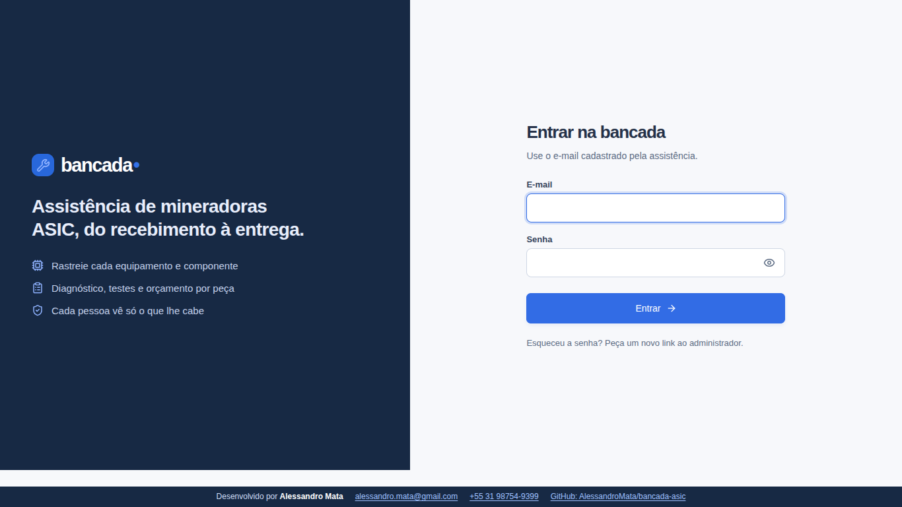
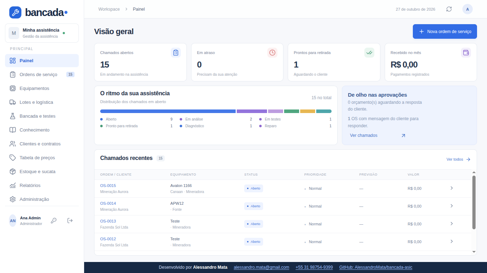
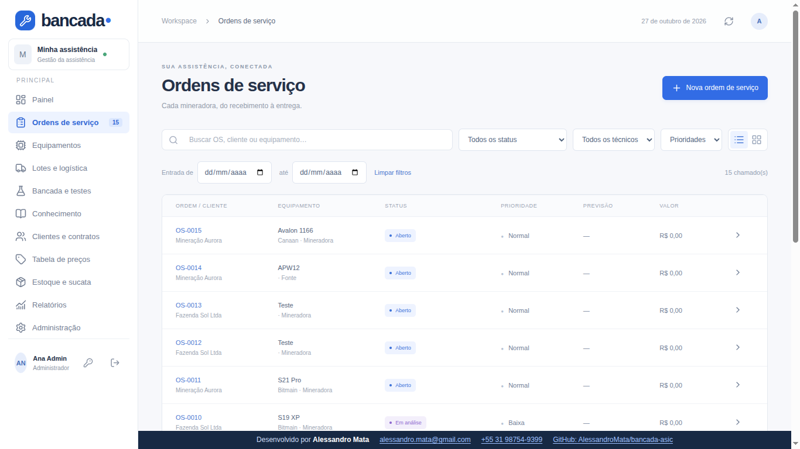
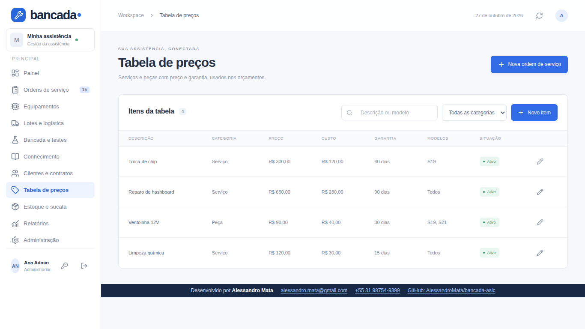
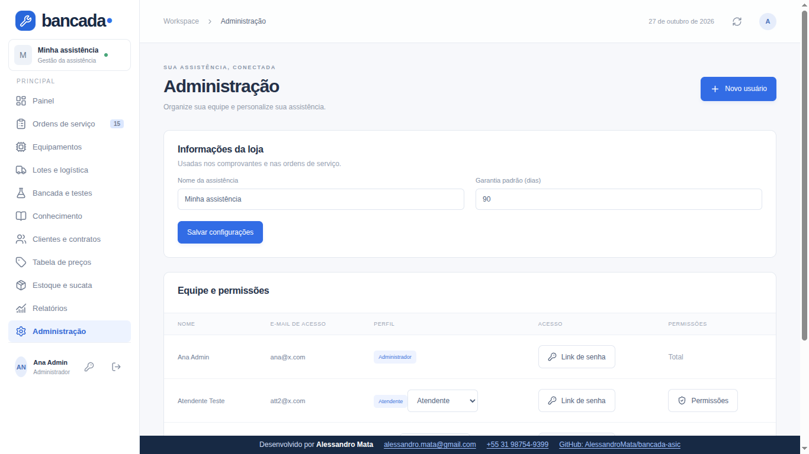

# Bancada

**Gestão completa para assistências técnicas de mineradoras ASIC.** Do check-in do equipamento à entrega, com rastreabilidade por peça, testes registrados, orçamento por componente e um canal direto com o cliente.

[](LICENSE)


> Código aberto sob a [licença MIT com requisito de atribuição](LICENSE): você pode usar, modificar e **comercializar**, desde que mantenha o aviso de autoria e o crédito visível no rodapé do sistema. Veja [Autor e licença](#autor-e-licença).

## Sumário

1. [Telas](#telas)
2. [O que o sistema faz](#o-que-o-sistema-faz)
3. [Perfis e permissões](#perfis-e-permissões)
4. [Tecnologia e arquitetura](#tecnologia-e-arquitetura)
5. [Rodando localmente](#rodando-localmente)
6. [Configuração](#configuração)
7. [Implantação](#implantação)
8. [Backup e restauração](#backup-e-restauração)
9. [Segurança](#segurança)
10. [Estrutura do projeto](#estrutura-do-projeto)
11. [Testes](#testes)
12. [Limitações conhecidas](#limitações-conhecidas)
13. [Contribuindo](#contribuindo)
14. [Autor e licença](#autor-e-licença)

O catálogo completo, por etapa e por perfil, está em [`FUNCIONALIDADES.md`](FUNCIONALIDADES.md). A documentação de **uso** (passo a passo para a equipe) está em [`GUIA-ASIC.md`](GUIA-ASIC.md) e [`GUIA.md`](GUIA.md). Este arquivo é voltado a quem instala, opera e desenvolve o sistema.

## Telas

Capturas com dados fictícios de demonstração.

| | |
|---|---|
| **Entrada** — login por e-mail e senha<br> | **Painel** — indicadores e chamados recentes<br> |
| **Ordens de serviço** — busca e filtros por status, técnico e prioridade<br> | **Tabela de preços** — preço, custo, garantia e modelos<br> |
| **Administração** — equipe, perfis e permissões<br> | |

## O que o sistema faz

### Entrada do equipamento
- **Nova OS sempre nasce de um equipamento ASIC** (mineradora, hashboard, fonte ou controladora), existente ou cadastrado na hora. Toda OS é vinculada a um equipamento; a API antiga, que criava OS soltas, está bloqueada.
- **Check-in com fotos:** várias fotos de uma vez (câmera ou galeria), reduzidas no próprio aparelho para não estourar o limite de envio.
- **Estado de entrega:** *máquina completa* ou *faltando itens* (hashboard, fonte, controladora, ventoinha, cabos, carcaça, dissipadores, parafusos e outros), registrado na OS e visível ao cliente.
- **Número de série obrigatório** e real (recusa "sem", "n/a", "0000"…) ou a opção **"Ilegível"**, que gera um identificador único. Pode ser corrigido depois, com motivo e registro de auditoria.
- **Cadastro de cliente na hora** pelo botão **+ Novo**, em uma única operação com o equipamento e a OS.

### Rastreabilidade
- QR Code e etiqueta de cada equipamento (gerados localmente, sem serviço externo).
- Composição da mineradora (hashboards, fonte, controladora), transferência de componentes entre mineradoras do mesmo cliente e histórico com responsável.
- **Lotes** de fazendas: recebimento por remessa, conferência e uma OS individual por equipamento; devolução parcial ou total com embalagem fotografada, transportadora, rastreio e comprovante.

### Reparo e testes
- **Diagnóstico guiado:** roteiros versionados por modelo e revisão exatos, checklist e **mapa de defeitos** por coordenadas na hashboard.
- **Testes de estabilidade:** bancadas e instrumentos com calibração e validade, reserva de horário sem conflito, sessão antes/depois com amostras reais e aprovação calculada pelos critérios do roteiro (hashrate, temperatura, consumo, erros, duração, chips).
- **Firmware:** versão recebida e entregue, autorização do cliente, backup de acesso restrito à equipe.
- **Retorno e garantia:** prazo calculado por componente a partir da entrega, classificação do retorno e controle de reincidência.
- **Sucata e peças:** placas doadoras, componentes recuperados com lote, destino e autorização do cliente.
- **Viabilidade:** reparar, substituir ou devolver, com as premissas registradas (sem promessa de rentabilidade).

### Comercial
- **Tabela de preços** (serviços e peças com preço, custo, garantia e modelos): o técnico escolhe o item e **o preço vem do servidor, nunca do campo digitado**. Item fora da tabela fica marcado para conferência.
- **Orçamento e decisão por componente**, com histórico de decisões e limite de aprovação por contrato.
- **Comentários** na OS e nos itens, cada um *interno* (oculto) ou *visível ao cliente*.
- **Contratos** (vigência, SLA em horas, prioridade, limite de aprovação), visitas e **preventivas** com próxima data gerada automaticamente.
- **Indicadores:** tempo até a entrega, primeiro teste aprovado, reincidência, margem orçada, falhas por modelo/revisão/ponto, ocupação de bancada.
- **Laudo técnico** para impressão em PDF, etiquetas e exportação CSV (com proteção contra injeção de fórmulas).

### Cliente
- **Portal com login:** equipamentos, OS, laudos, mensagens e aprovação do orçamento por componente, conforme contrato e limite.
- **Painel por código** (recurso opcional, `PLANO=pago`): link ou código de 12 caracteres, **sem login**, somente do que a assistência liberou. O cliente envia **mensagens, respostas rápidas e fotos**, sempre vinculadas a uma OS aberta. Pode ser ativado, pausado ou renovado por cliente.
- **Acompanhamento público** por link da OS (`/?acompanhar=…`), com status e recado.

### Acesso
- Login por e-mail e senha; troca de e-mail e de senha pela própria pessoa; convite por link de uso único; recuperação por e-mail (opcional).
- Perfis com **permissões granulares por usuário** (veja abaixo) e auditoria de cada alteração.

## Perfis e permissões

| Perfil | Para quem | Pode, por padrão |
|---|---|---|
| **Administrador** | Dono/gestor | Tudo, sempre (não pode ser restringido). Usuários, perfis, backup, contratos e configurações são **só dele**. |
| **Atendente** | Balcão | Abrir OS, cadastrar clientes e equipamentos, orçamentos, decisões, pagamentos, lotes e logística. Vê custos. |
| **Técnico** | Bancada | Só as OS atribuídas: diagnóstico, testes, firmware, peças, fotos e orçamento pela tabela. **Não vê custo** nem define desconto. |
| **Cliente** | Fazenda/empresa | Só os dados da própria empresa, sem custos, notas internas nem dados de outros clientes. |

O administrador pode **liberar ou bloquear** oito itens por atendente ou técnico (*Administração → Permissões*): ver custos, montar orçamentos, decidir/dar desconto, gerenciar a tabela de preços, cadastrar clientes, registrar pagamentos, gerenciar estoque e gerenciar o painel do cliente. Os padrões reproduzem a tabela acima; trocar o perfil de alguém restaura o padrão do novo perfil. A regra está centralizada em [`lib/perms.mjs`](lib/perms.mjs) (`can()`), e quem não pode ver custos não recebe o custo em lugar nenhum da resposta do servidor.

## Tecnologia e arquitetura

- **Front-end:** Next 16 (via [vinext](https://github.com/cloudflare/vinext)), React 19 e TypeScript; interface em português, responsiva.
- **Execução:** um único *Worker* (`worker/index.ts`) que atende páginas e API. Roda na Cloudflare (Workers + D1 + R2) ou no runtime local da Cloudflare (`wrangler dev --local`), com SQLite e fotos em disco.
- **Dados:** SQLite (D1). Em vez de uma tabela por entidade, cada registro é um documento JSON em `records(collection, id, data)`; uma tabela `store` guarda a versão global. **Toda gravação usa versão otimista e um nonce**: duas pessoas gravando ao mesmo tempo nunca sobrescrevem uma à outra (a segunda recebe conflito e tenta de novo).
- **Credenciais separadas:** senhas, sessões e limites de tentativa ficam em `credentials`, `tokens` e `attempts`, **fora** dos documentos, do backup JSON e das respostas da API.
- **Regras de negócio** em `lib/`, em JavaScript puro e testável sem servidor. O servidor é a única fonte de autorização: a interface só esconde o que o servidor já recusaria.
- **Fotos:** guardadas no R2 (ou em disco no modo local), com chave aleatória e entrega sempre como anexo, com `nosniff` e CSP restritiva.

### Rotas da API

| Rota | Função |
|---|---|
| `GET/POST /api/data` | Estado visível ao usuário e todas as operações (`action` + `payload`) |
| `POST /api/files`, `GET /api/files?key=` | Envio e download de anexos, com checagem de escopo e visibilidade |
| `GET /api/backup` | Exportação JSON dos registros (só administrador) |
| `GET /api/track?token=` | Acompanhamento público de uma OS |
| `POST /api/painel`, `/api/painel/message`, `/api/painel/photo` | Painel do cliente por código |
| `POST /api/auth/login`, `logout`, `password`, `email` | Sessão e conta |
| `POST /api/auth/setup`, `invite`, `accept`, `forgot` | Primeiro administrador, convites e recuperação |

### Banco de dados

Migrações em [`drizzle/`](drizzle): `0000` (`store`, `records`), `0001` (índices de registros) e `0002` (`credentials`, `tokens`, `attempts`). Coleções de documentos: usuários, clientes, ordens, peças e movimentos, equipamentos e eventos, lotes, roteiros, diagnósticos, defeitos, bancadas, reservas, sessões de teste, firmware, artigos, retornos, doadoras, recuperados, remessas, contratos, visitas, viabilidades, tabela de preços e auditoria.

## Rodando localmente

Requer **Node 22.13 ou superior**.

```sh
git clone https://github.com/AlessandroMata/bancada-asic.git
cd bancada-asic
npm ci
npm run build

# aplica as migrações em um banco local novo (rode apenas na primeira vez)
for f in drizzle/*.sql; do
  node --import ./scripts/sites-env.mjs ./node_modules/wrangler/bin/wrangler.js d1 execute DB --local \
    --config dist/server/wrangler.json --persist-to .wrangler/state --file "$f"
done

npm start -- --var SETUP_TOKEN:troque-este-codigo --var PLANO:pago
```

Abra o endereço indicado no terminal (por padrão `http://127.0.0.1:8787`). Na tela de entrada use **Primeiro acesso do administrador** com o `SETUP_TOKEN`: informe nome, e-mail e senha (mínimo de 10 caracteres). A opção some assim que existe qualquer usuário. Depois, crie as demais pessoas em *Administração → Novo usuário* e gere o **Link de senha** para cada uma definir a própria senha.

Para desenvolvimento com recarga automática, use `npm run dev`. O estado local fica em `.wrangler/state` (ignorado pelo Git); apague a pasta para recomeçar do zero.

## Configuração

Variáveis do servidor (em produção, segredos do ambiente; em desenvolvimento, `--var` ou um arquivo `.dev.vars`, que **nunca** vai para o repositório):

| Variável | Obrigatória | Para quê |
|---|---|---|
| `SETUP_TOKEN` | no primeiro acesso | Código para criar o primeiro administrador. Sem ele ninguém consegue; deixa de valer quando o primeiro usuário existe. |
| `PLANO` | não | `pago` liga o painel do cliente por código. Fica no servidor, fora do banco, para o cliente não se habilitar sozinho. |
| `RESEND_API_KEY`, `MAIL_FROM` | não | Envio de e-mail (convite e recuperação de senha). **O e-mail é opcional**: sem eles, o administrador copia o link e envia por onde preferir. |

## Implantação

### Servidor próprio, um ambiente isolado por cliente (recomendado)

[`deploy/instalar.mjs`](deploy/instalar.mjs) instala (ou atualiza) um cliente em um servidor com Docker, **sem nenhuma porta publicada**: o acesso é somente por **Cloudflare Tunnel**, o TLS termina na Cloudflare e o IP do servidor não é exposto.

```sh
DEPLOY_HOST=usuario@servidor DEPLOY_SSH_KEY=~/.ssh/chave \
CLOUDFLARE_API_TOKEN=… CLOUDFLARE_ACCOUNT_ID=… CLOUDFLARE_ZONE_ID=… \
node deploy/instalar.mjs --slug cliente --domain cliente.exemplo.com.br [--plano pago]
```

O script, em ordem: cria o túnel e o DNS na Cloudflare (falhando cedo se o token não puder escrever), faz o build, envia o contexto e constrói a imagem no servidor, grava a configuração e os segredos (modo `600`), sobe os containers e confere que o endereço responde. Imprime o `SETUP_TOKEN` **uma única vez**.

- **Isolamento:** cada cliente tem containers, banco e fotos próprios em `/opt/clients/<slug>`. O container do sistema fica numa rede interna **sem saída para a internet**, com `cap_drop: ALL` e `no-new-privileges`.
- **Atualizar** é rodar o mesmo comando de novo: reconstrói a imagem e **mantém dados, administradores e o `SETUP_TOKEN`**.
- O token da Cloudflare precisa de: Cloudflare Tunnel (editar) na conta e DNS (editar) na zona.
- O servidor precisa de Docker e Docker Compose; o script não usa nginx nem abre portas.

### Cloudflare Workers + D1 + R2

[`deploy/cliente.mjs`](deploy/cliente.mjs) cria Worker, banco D1 e bucket R2 próprios de um cliente e o domínio. Exige R2 habilitado na conta. Foi validado em modo seco (configuração e migrações), mas o caminho de produção documentado e testado é o do servidor próprio acima.

## Backup e restauração

O ambiente instalado pelo script faz **backup diário às 3h40** em `/opt/backups/<slug>`, com retenção de 14 dias: cópia consistente do banco (via `sqlite3 .backup`) e das fotos num `.tgz`. A integridade e as tabelas de um backup foram verificadas por restauração em diretório temporário.

Restauração (procedimento a validar no seu ambiente antes de depender dele):

1. Pare o container: `docker compose -f /opt/clients/<slug>/compose.yml stop app`.
2. Extraia o `.tgz` em uma pasta temporária e copie `bk/<hash>.sqlite` sobre `data/v3/d1/miniflare-D1DatabaseObject/<hash>.sqlite` (apague os arquivos `-wal` e `-shm` desse banco); restaure `v3/r2` em `data/v3/r2`.
3. Suba de novo: `docker compose … start app`.

> **Limites:** o backup fica no **mesmo servidor** por padrão, então não protege contra perda do disco; copie `/opt/backups/<slug>` para outro lugar. O painel não tem restauração por upload, e o JSON do administrador exporta dados, não os bytes das fotos.

## Segurança

- **Autorização no servidor:** `lib/perms.mjs` e `lib/asic.mjs` decidem tudo; o front só reflete. Respostas são filtradas por perfil, por cliente e por permissão.
- **Senhas** com PBKDF2-SHA256 (100 mil iterações, sal por usuário); sessões, convites e códigos de acesso guardados **apenas como hash**; comparações em tempo constante; mensagens de erro de login idênticas para e-mail inexistente e senha errada.
- **Limite de tentativas** por e-mail e por IP em login, setup, recuperação, troca de senha e painel por código. O painel trava por IP, nunca por código (ninguém consegue travar o painel de outro cliente), e o código tem cerca de 59 bits de entropia.
- **CSRF:** toda gravação confere a origem. **Cookies** `HttpOnly`, `SameSite=Lax` e `Secure`.
- **Cabeçalhos** em todas as respostas: `X-Frame-Options: DENY`, `frame-ancestors 'none'`, `nosniff`, `Referrer-Policy` e `Permissions-Policy`. `X-Forwarded-Proto` só pode *subir* uma conexão para https, nunca rebaixá-la.
- **Anexos:** chave aleatória, tipo e tamanho validados, entrega como anexo com CSP restritiva. Backups de firmware nunca vão ao portal.
- **Dados:** SQL sempre parametrizado; sem `dangerouslySetInnerHTML` com dados de usuário; CSV com neutralização de fórmulas.
- **Implantação:** segredos só no servidor (modo `600`), containers sem privilégios e sem porta publicada.

O código passou por uma **revisão de segurança independente** antes de ser publicado (sem achados críticos ou altos; os achados médios e baixos foram corrigidos) e o repositório é verificado com *gitleaks* a cada versão. Encontrou uma vulnerabilidade? Abra uma **security advisory privada** neste repositório (*Security → Report a vulnerability*) em vez de uma issue pública.

## Estrutura do projeto

```
app/                páginas e rotas (App Router)
  api/              rotas da API (auth, data, files, painel, backup, track)
  *.tsx             telas: ui (sistema), asic-ui (módulos ASIC e portal),
                    auth-ui, panel-ui, clients-ui, prices-ui, perms-ui, comments-ui,
                    photos-ui, credits (rodapé do autor)
lib/                regras de negócio e testes (perms, asic, domain, auth, http, storage…)
db/                 esquema (Drizzle) das tabelas relacionais
drizzle/            migrações SQL
worker/             entrada do Worker (cabeçalhos de segurança e conectores)
deploy/             implantação por cliente (Docker + Cloudflare Tunnel; Workers)
docs/img/           capturas de tela do README
marketing/          gerador do folder de divulgação (HTML → PNG)
components/ui/      componentes de interface (shadcn)
scripts/            utilitários de build do template
```

## Testes

```sh
node --test lib/*.test.mjs   # 48 testes de regras de negócio, permissões, isolamento e segurança
npx tsc --noEmit             # verificação de tipos
npm run lint
```

Os testes cobrem, entre outros pontos: isolamento entre clientes e entre perfis, vazamento de custos e dados internos, preço vindo do servidor, série obrigatória, código do painel (alfabeto, viés e normalização), limites de abuso, origem e protocolo atrás de proxy, e cada permissão granular nos pontos de checagem.

## Limitações conhecidas

- **Sem monitoramento automático de hardware:** as medições dos testes são registradas pela equipe; o sistema não lê a mineradora, não grava firmware nem integra pools, transportadoras, nota fiscal ou pagamentos.
- **Documentos:** o laudo em PDF usa a impressão do navegador; o WhatsApp abre uma mensagem para revisão e envio manual.
- **Escala:** cada requisição carrega os registros autorizados em memória. Adequado para uma assistência de porte pequeno a médio; volumes muito grandes pedirão paginação e consultas específicas no SQL.
- **Runtime local da Cloudflare** no servidor próprio: funciona bem para um cliente por container, mas não é o runtime pensado para produção em larga escala.
- **Permissões** são fixas por tipo de ação; não há construtor de perfis nomeados. O administrador altera apenas o próprio e-mail, e o cliente do portal não troca o e-mail sozinho.
- **Backup** fora do servidor e restauração por tela ainda não existem.

## Contribuindo

Contribuições são bem-vindas, conforme a [licença](LICENSE). Antes de abrir um *pull request*: rode `node --test lib/*.test.mjs` e `npx tsc --noEmit`; mantenha a regra de autorização **no servidor** e cubra mudanças de comportamento com teste; não inclua segredos, dados de clientes nem endereços de servidores. Mudanças de segurança devem ser reportadas em privado (veja acima).

## Autor e licença

Desenvolvido por **Alessandro Mata**

- E-mail: [alessandro.mata@gmail.com](mailto:alessandro.mata@gmail.com)
- Telefone: [+55 31 98754-9399](tel:+5531987549399)
- GitHub: [github.com/AlessandroMata/bancada-asic](https://github.com/AlessandroMata/bancada-asic)

Licença [MIT com requisito de atribuição](LICENSE): uso, cópia, modificação, distribuição e venda são permitidos, inclusive em produtos comerciais, desde que (1) o aviso de direitos autorais e a licença acompanhem o código e (2) o crédito ao autor (nome e contato) continue **visível na interface**, no rodapé fixo (`app/credits.tsx`), sem remover os cabeçalhos de autoria dos arquivos. Versões modificadas devem informar que foram modificadas, mantendo o crédito original. Sem garantia de nenhum tipo.
